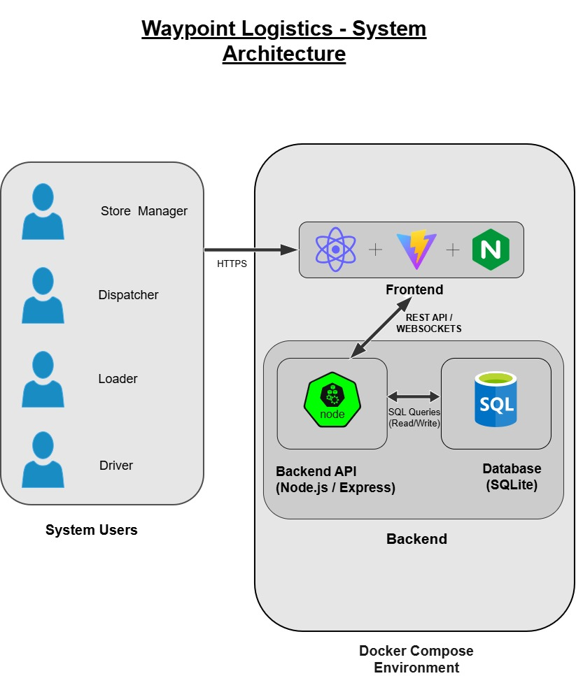

# Waypoint Logistics

A full-stack logistics management platform for delivery planning and fleet allocation. It has smart vehicle routing, offline-first driver syncing, and a connected workflow for four roles. It is built to manage a shared delivery fleet across a multi-brand retail network (Fresh, Style, Tech).

This is our first team project, built to learn web development.

## Live Deployment

* **URL:** https://waypoint-logistics-63e55.containers.snapdeploy.app/
* Deployed as a Docker container on SnapDeploy.

## Demo Video

* **YouTube:** https://youtu.be/11eVEYJOyFE

## Demo Accounts (seeded)

| Role | Email | Password |
| :--- | :--- | :--- |
| Store Manager | storemanager@waypoint.lk | password123 |
| Dispatcher | dispatcher@waypoint.lk | password123 |
| Loader | loader@waypoint.lk | password123 |
| Driver | driver@waypoint.lk | password123 |

## Run Locally

Requirements: Docker Desktop.

```bash
docker compose up --build
```
Then open [http://localhost:3000](http://localhost:3000). The SQLite database is created and filled from the CSV files on the first start, so every rebuild starts with all 85 orders in PENDING.

*(Tip: You can use a tool like `ngrok` to share your local port 3000 on the internet, so you can test on a mobile phone.)*

## Project Walkthrough

Use the live URL or the local one. Keep each role in its own browser tab (or log out between roles).

1. **Store Manager:** log in, pick an outlet, add items to the cart (Ambient / Chilled tabs), and press Submit Daily Order. The order appears under *My Orders & Deliveries* with a live status.
2. **Dispatcher:** log in. Press Auto-Allocate All Pending (or Auto-Allocate on a single order), then Assign. Orders that cannot be served show a reason and can be Deferred. The *Live Trips* panel shows assigned trips. The screen refreshes every 5 seconds.
3. **Loader:** log in. Only assigned orders appear, grouped by truck and trip, with the LIFO loading rule. Press Mark Loaded.
4. **Driver:** log in (best on a phone-sized screen). Loaded orders appear as stops. Press Confirm Delivery (proof of delivery). **Offline test:** in Chrome DevTools, open the Network tab and set *Offline*. Confirm a delivery (it shows SAVED OFFLINE - PENDING SYNC), then set the network back to *No throttling*. The saved delivery syncs automatically (or press Retry sync).
5. **Store Manager:** open the delivered order and press Confirm Receipt & Inspect. Enter the received quantity, condition, a note and a signature. The order becomes RECEIVED.

Note: the dataset represents a peak day, so a new store order may be marked **Over Capacity** because it has the lowest priority.

## Order Status Flow

`PENDING` -> `ALLOCATED` or `OVER_CAPACITY` -> `ASSIGNED` -> `LOADED` -> `DELIVERED` -> `RECEIVED`

An order can also be `DEFERRED` (from PENDING, ALLOCATED or OVER_CAPACITY), always with a reason that people can read.

## Fleet Allocation Logic

Implemented in `backend/allocation.js` (`runAllocation`). The backend enforces these rules:

* Depot match between order and vehicle
* Chilled orders only on reefer vehicles
* `van_only` outlets only on vans
* Weight and volume capacity per vehicle across all its orders
* Maximum 2 trips per vehicle per day
* Daily time limit: Fresh 270 minutes, Style + Tech 480 minutes (trip time = outbound travel + travel between stops + handling time)
* Orders merge into one trip only for the same brand and district
* Priority: deferred yesterday, longest unserved, Fresh first, earliest window close, heavier first
* A clear reason for every order that is not served

## Offline Operation and Recovery (Driver)

* Delivery confirmations are saved in the browser (localStorage) when the server cannot be reached
* Automatic sync every 8 seconds, when the network returns, and with a manual *Retry sync* button
* The job list is cached, so the Driver can keep working without network coverage
* An offline banner and a clear *pending sync* state for each stop

## Architecture



The system runs in a Docker Compose environment:

* **Frontend:** a React + Vite + Tailwind CSS app. It is built into static files and served by **Nginx**.
* **Backend:** a Node.js + Express REST API that also contains the Allocation Engine (`backend/allocation.js`).
* **Database:** a file-based SQLite database used by the backend.
* **Users:** Store Manager, Dispatcher, Loader and Driver use the web app over HTTPS. The frontend talks to the backend through the REST API.

The diagram shows the Docker Compose setup used for local development. The live deployment runs as a single container built from the root `Dockerfile`.

## Repository Structure

```text
backend/            Express API, allocation logic, CSV data, SQLite seeding
  Dockerfile        Backend container build
frontend/           React + Vite + Tailwind app (pages per role)
  Dockerfile        Frontend container build
  nginx.conf        Nginx settings for serving the frontend
docs/               Architecture diagram
docker-compose.yml  Runs the frontend and backend together
Dockerfile          Root Docker build file (used for the live deployment)
.env                Environment settings (not committed)
```

## Known Limitations

* Delivery windows and weekly fuel quotas are not yet enforced by the allocation engine
* Photo evidence upload, barcode scanning and *Flag Missing/Damage / Report Delay / Issue* are UI placeholders only
* Sign-in uses fixed demo accounts (no real authentication)
* The item catalogue uses demo weights and volumes
* No automated tests are set up
* The database lives inside the container, so a rebuild resets it to the starting seeded data